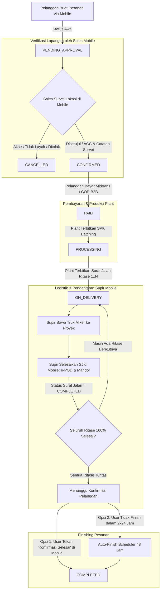

# Rencana Implementasi: Operasional Mobile Lapangan (Sales & Supir) serta Alur Konfirmasi Pesanan

Dokumen rencana kerja ini merangkum arsitektur, peran operasional lapangan, spesifikasi API, dan alur status pesanan terbaru untuk aplikasi Mobile Tonasa/PKM dan Backend Laravel Dashboard.

---

## 1. Ringkasan Kebutuhan & Kondisi Terkini

### A. Sales Login di Mobile (Bukan di Web Dashboard)
- **Web Dashboard** (`dashboard/`) diperuntukkan murni bagi manajemen kantor pusat dan operator batching plant (Admin & Operator Plant).
- **Petugas Sales Lapangan** beroperasi penuh melalui aplikasi **Mobile** (`mobile/`).
- Tugas utama Sales di Mobile:
  1. Menerima pesanan baru berstatus `PENDING_APPROVAL`.
  2. Memverifikasi kelayakan akses jalan proyek untuk armada truk mixer besar (kapasitas 7 m³ / tronton / bobot 20–25 ton).
  3. Menyesuaikan titik bongkar armada (geser pin peta bila proyek berada di lorong sempit).
  4. Mencatat catatan hasil survei lapangan (`survey_notes`).
  5. Menyetujui (**ACC**) atau **Menolak** pesanan (`rejection_reason`).
  6. Ketika pesanan di-ACC, status berubah menjadi `CONFIRMED` dan tombol pembayaran Midtrans di aplikasi pelanggan aktif.

### B. Supir Login di Mobile & Selesai Pengantaran Surat Jalan
- **Supir Armada (Driver)** login melalui aplikasi Mobile.
- Tugas utama Supir di Mobile:
  1. Melihat daftar Surat Jalan ritase aktif yang ditugaskan ke nomor HP / akunnya.
  2. Membuka navigasi rute ke lokasi proyek (Google Maps).
  3. Menyelesaikan pengantaran fisik (**e-POD**) setelah beton dibongkar di proyek:
     - Input nama mandor / PIC penerima lapangan.
     - Mengubah status Surat Jalan menjadi `COMPLETED` dan status item menjadi `DELIVERED`.

### C. Alur Penyelesaian Pesanan (Customer Finish & Auto-Finish 48 Jam)
- **ATURAN MUTLAK**: Ketika supir menyelesaikan Surat Jalan ritase terakhir, status Pesanan (`Order`) **TIDAK OTOMATIS BERUBAH MENJADI `COMPLETED`**.
- Status Pesanan diselesaikan oleh **Pelanggan (Customer / User B2C)** di aplikasi Mobile:
  - Pelanggan menerima notifikasi bahwa seluruh pengantaran beton telah tiba di proyek.
  - Pelanggan memeriksa rincian serah terima dan menekan tombol: **"Konfirmasi Pesanan Diterima & Selesai"**.
  - Status Pesanan resmi berubah menjadi `COMPLETED`.
- **Mekanisme Fallback Otomatis (Auto-Finish 2 x 24 Jam / 48 Jam)**:
  - Jika pelanggan tidak menekan tombol konfirmasi selesai dalam waktu **2 x 24 jam (48 jam)** terhitung sejak Surat Jalan ritase terakhir diselesaikan oleh supir, maka:
  - Sistem via Scheduled Command / Background Job (`php artisan orders:auto-complete` yang berjalan tiap jam) secara otomatis mengubah status Pesanan menjadi **`COMPLETED`** (`completed_by = 'SYSTEM_TIMEOUT'`).
  - Hal ini mencegah status pesanan menggantung selamanya jika pelanggan tidak lagi membuka aplikasi setelah proyek pengecorannya selesai.

---

## 2. Diagram Alur Status Pesanan (End-to-End)



---

## 3. Kredensial Pengguna Seeder

Pendaftaran akun bawaan untuk pengujian & operasional di `database/seeders/MasterDataSeeder.php`:

| Role | Nama | Email | Nomor HP | Password | Cabang | Catatan |
|------|------|-------|----------|----------|--------|---------|
| `sales` | **Budi Hartono (Sales Lapangan)** | `sales@pkm.test` | `081241129902` | `password` | SULSEL (`BR-SULSEL-01`) | Login via Mobile untuk survei akses jalan & ACC order |
| `driver` | **Pak Syamsuddin (Sopir)** | `sopir@pkm.test` | `081241129901` | `password` | SULSEL (`BR-SULSEL-01`) | Login via Mobile untuk pengiriman Surat Jalan & e-POD |
| `customer` | **H. Syamsuddin (Pelanggan)** | `customer@pkm.test` | `081300000001` | `password` | Bebas (B2C) | Login via Mobile untuk pemesanan & konfirmasi finish pesanan |

---

## 4. Komponen Perubahan yang Direncanakan

### A. Database & Model Backend (`dashboard/`)

1. **Enum `Modules/Shared/app/Enums/UserRole.php`**:
   - Menambahkan enum case:
     ```php
     case Admin = 'admin';
     case User = 'user';       // Operator Plant
     case Sales = 'sales';     // Sales Lapangan Mobile
     case Driver = 'driver';   // Sopir Armada Mobile
     ```

2. **Tabel `users`**:
   - Migration: penambahan kolom `phone` (string 32, nullable, unique).

3. **Tabel `surat_jalans`**:
   - Migration: penambahan kolom `driver_id` (foreignId ke `users`, nullable, nullOnDelete).

4. **Tabel `orders`**:
   - Kolom verifikasi (sudah ada):
     - `approved_at` (timestamp, nullable)
     - `approved_by_id` (foreignId ke `users`, nullable)
     - `survey_notes` (text, nullable)
     - `rejection_reason` (text, nullable)
   - Kolom penyelesaian:
     - `delivered_at` (timestamp, nullable: waktu saat seluruh ritase SJ tuntas)
     - `customer_confirmed_at` (timestamp, nullable: waktu saat pelanggan klik finish)
     - `completed_by` (string 32, nullable: `'CUSTOMER'` atau `'SYSTEM_TIMEOUT'`)

5. **Scheduled Artisan Command `orders:auto-complete`**:
   - Class: `Modules\Order\Console\Commands\AutoCompleteOrdersCommand`
   - Logika:
     ```php
     Order::query()
         ->where('status', 'ON_DELIVERY')
         ->whereNotNull('delivered_at')
         ->where('delivered_at', '<=', now()->subHours(48))
         ->whereRaw('fulfilled_quantity >= quantity')
         ->each(function (Order $order) {
             $order->update([
                 'status' => 'COMPLETED',
                 'completed_by' => 'SYSTEM_TIMEOUT',
                 'customer_confirmed_at' => now(),
             ]);
         });
     ```
   - Didaftarkan pada scheduler (`routes/console.php`): `$schedule->command('orders:auto-complete')->hourly();`

---

### B. Endpoint API Mobile Backend (`dashboard/routes/api.php` / Modul Terkait)

#### 1. Modul Sales Mobile (`Modules/Order/` / `Modules/Sales/`)
- `POST /api/sales/v1/login`: Login Sales dengan Nomor HP/Email + Password. Mengembalikan token Sanctum dan memverifikasi `role === 'sales'`.
- `GET /api/sales/v1/me`: Mendapatkan data profil sales aktif dan cabang yang ditugaskan.
- `GET /api/sales/v1/orders`: Daftar pesanan yang butuh verifikasi (`PENDING_APPROVAL`) dan riwayat ACC/ditolak.
- `GET /api/sales/v1/orders/{uuid}`: Detail koordinat pemesan, produk pesanan, jarak estimasi plant, dan alamat proyek.
- `POST /api/sales/v1/orders/{uuid}/approve`: Aksi ACC pesanan:
  - Input: `delivery_lat`, `delivery_lng`, `delivery_address`, `survey_notes`.
  - Mengubah status order menjadi `CONFIRMED`.
  - Mengkalkulasi ulang jarak & ongkir jika titik disesuaikan.
- `POST /api/sales/v1/orders/{uuid}/reject`: Aksi tolak pesanan:
  - Input: `rejection_reason`.
  - Mengubah status order menjadi `CANCELLED`.

#### 2. Modul Supir Mobile (`Modules/Dispatch/`)
- `POST /api/driver/v1/login`: Login Supir dengan Nomor HP/Email + Password. Memverifikasi `role === 'driver'`.
- `GET /api/driver/v1/me`: Mendapatkan profil supir.
- `GET /api/driver/v1/deliveries`: Daftar Surat Jalan yang ditugaskan (`driver_id = auth()->id() OR driver_phone = auth()->user()->phone`).
- `POST /api/driver/v1/deliveries/{uuid}/complete`: Aksi menyelesaikan Surat Jalan:
  - Update Surat Jalan menjadi `COMPLETED` dan waktu tiba `now()`.
  - Update item menjadi `DELIVERED`, waktu diterima `now()`, dan nama penerima mandor.
  - Sinkronisasi pemenuhan order (`fulfilled_quantity`).
  - **PENTING**: Jika seluruh ritase pesanan tuntas 100%, sistem mencatat `delivered_at = now()` pada tabel `orders`, **namun status order TETAP `ON_DELIVERY`** (menunggu konfirmasi user atau auto-finish 48 jam).

#### 3. Modul Pelanggan Mobile (`Modules/Customer/` & `Modules/Order/`)
- `POST /api/customer/v1/orders/{uuid}/confirm-complete`:
  - Aksi tombol "Pesanan Diterima & Selesai" oleh pelanggan.
  - Memastikan seluruh ritase pengiriman telah berstatus `COMPLETED` (`fulfilled_quantity >= quantity`).
  - Update `orders.status` menjadi `COMPLETED`, `customer_confirmed_at = now()`, `completed_by = 'CUSTOMER'`.

---

### C. Antarmuka Pengguna Mobile (`mobile/src/`)

#### 1. Multi-Role Login (`mobile/src/features/auth/LoginPage.tsx`)
- Tampilan segmented switch di atas form login:
  - **[ Pelanggan ]**: Form login nomor HP dengan pilihan Kata Sandi atau WhatsApp OTP. Link registrasi baru.
  - **[ Staf Lapangan ]**: Form login untuk **Sales** & **Sopir Armada** (Nomor HP / Email + Password).
- Handler login staf mendeteksi role:
  - Jika role `sales` ➔ diarahkan ke `/sales/orders`.
  - Jika role `driver` ➔ diarahkan ke `/driver/deliveries`.
  - Jika bukan role staf lapangan ➔ tampilkan notifikasi penolakan akses.

#### 2. Fitur Sales Lapangan (`mobile/src/features/sales/`)
- **`SalesOrdersPage.tsx`**:
  - Tab segmented: **Perlu Survei (Pending)** | **Riwayat (Disetujui/Ditolak)**.
  - Kartu pesanan: ID pesanan, nama customer, alamat proyek, volume total m³, estimasi jarak.
- **`SalesOrderDetailPage.tsx`**:
  - Peta Interaktif Mobile (Leaflet):
    - Marker Plant Asal (🏭) & Marker Titik Truk Mixer (🚚 draggable).
    - Jarak km otomatis berubah saat pin digeser ke jalan utama terdekat.
  - Form input: Alamat akses penyesuaian & Catatan Survei (`survey_notes`).
  - Tombol aksi:
    - **"Setujui & ACC Lokasi"** (Hijau emerald).
    - **"Tolak Akses Tidak Memungkinkan"** (Merah).

#### 3. Fitur Supir Armada (`mobile/src/features/driver/`)
- **`DriverDeliveriesPage.tsx`**:
  - Tampilan ergonomis lapangan (kontras tinggi, tombol besar).
  - Kartu Surat Jalan aktif: No Surat Jalan, Nopol Truk, Volume beton, Alamat Proyek.
  - Tombol **"Buka Navigasi Rute"** (membuka aplikasi Google Maps ke titik koordinat tujuan).
  - Tombol **"Selesaikan Pengantaran"**:
    - Modal popup input: Nama Penerima Lapangan (Mandor/PIC) & Catatan serah terima.
    - Konfirmasi selesai ➔ status Surat Jalan berganti hijau (*Selesai*).

#### 4. Fitur Pelanggan (`mobile/src/features/orders/OrderDetailPage.tsx`)
- Status stepper 5 tahap:
  1. **Menunggu Verifikasi**: Menunggu tim sales mengecek akses jalan.
  2. **Dikonfirmasi**: Disetujui sales, pelanggan dapat melakukan pembayaran.
  3. **Diproses**: Batching plant memproses SPK beton.
  4. **Dalam Pengiriman**: Truk mixer dalam perjalanan menuju proyek.
  5. **Selesai**: Pesanan telah diterima dan tervalidasi.
- **Banner Pesanan Tiba & Tombol Konfirmasi Selesai**:
  - Muncul ketika seluruh Surat Jalan telah diselesaikan oleh supir:
    > "Semua pengiriman beton telah diserahterimakan di lokasi proyek Anda. Silakan periksa volume dan konfirmasi penyelesaian pesanan."
  - Teks info tenggat auto-finish:
    > "Pesanan akan otomatis ditutup dalam waktu 2x24 jam jika tidak ada konfirmasi."
  - Tombol aksi utama: **"Konfirmasi Pesanan Diterima & Selesai"**.

---

## 5. Matriks Peran & Hak Akses (Dashboard vs Mobile)

| Fitur / Tindakan | Admin Web | Operator Plant Web | Sales Mobile | Supir Mobile | Pelanggan Mobile |
|------------------|:---------:|:------------------:|:------------:|:------------:|:----------------:|
| Login Web Dashboard | Ya | Ya | **Tidak** | **Tidak** | **Tidak** |
| Login Aplikasi Mobile | Tidak | Tidak | **Ya** | **Ya** | **Ya** |
| Buat Pesanan B2C | - | - | - | - | **Ya** |
| Survei & ACC Lokasi Truk | - | - | **Ya** | - | - |
| Terbitkan SPK & Campuran | Ya | **Ya** | - | - | - |
| Terbitkan Surat Jalan | Ya | **Ya** | - | - | - |
| Selesaikan Pengantaran SJ (e-POD) | - | - | - | **Ya** | - |
| Konfirmasi Selesai Pesanan (Finish) | - | - | - | **Tidak** | **Ya** |
| Auto-Finish Pesanan (2x24 Jam) | Sistem | Sistem | Sistem | Sistem | Sistem |

---

## 6. Skenario Pengujian Otomatis (Automated Testing)

File pengujian yang disiapkan di `dashboard/tests/Feature/`:

1. **`SalesMobileApiTest.php`**:
   - Login Sales via nomor HP & email berhasil menghasilkan token Sanctum.
   - User non-sales ditolak saat mengakses endpoint sales.
   - Sales dapat melihat daftar pesanan `PENDING_APPROVAL`.
   - Sales dapat menyetujui pesanan (status berubah menjadi `CONFIRMED`, `approved_by_id`, `survey_notes`, dan koordinat tersimpan).
   - Sales dapat menolak pesanan dengan alasan (status berubah menjadi `CANCELLED`).

2. **`DriverDeliveryApiTest.php`**:
   - Login Supir via nomor HP & email berhasil.
   - Supir dapat melihat daftar Surat Jalan miliknya.
   - Supir menyelesaikan Surat Jalan ➔ Surat Jalan `COMPLETED`, item `DELIVERED`, `delivered_at` terisi.
   - **Verifikasi**: Status Order **TETAP `ON_DELIVERY`** (tidak langsung menjadi `COMPLETED`).

3. **`CustomerOrderCompletionTest.php`**:
   - Pelanggan menekan `confirm-complete` sebelum pengantaran selesai ➔ Gagal / ditolak (HTTP 422).
   - Pelanggan menekan `confirm-complete` setelah seluruh ritase selesai ➔ Berhasil, status Order menjadi `COMPLETED`, `completed_by = 'CUSTOMER'`.

4. **`AutoCompleteOrdersCommandTest.php`**:
   - Order yang telah tuntas pengantaran selama 20 jam ➔ Status tetap `ON_DELIVERY`.
   - Order yang telah tuntas pengantaran > 48 jam (2x24 jam) ➔ Status otomatis diubah menjadi `COMPLETED`, `completed_by = 'SYSTEM_TIMEOUT'`.
